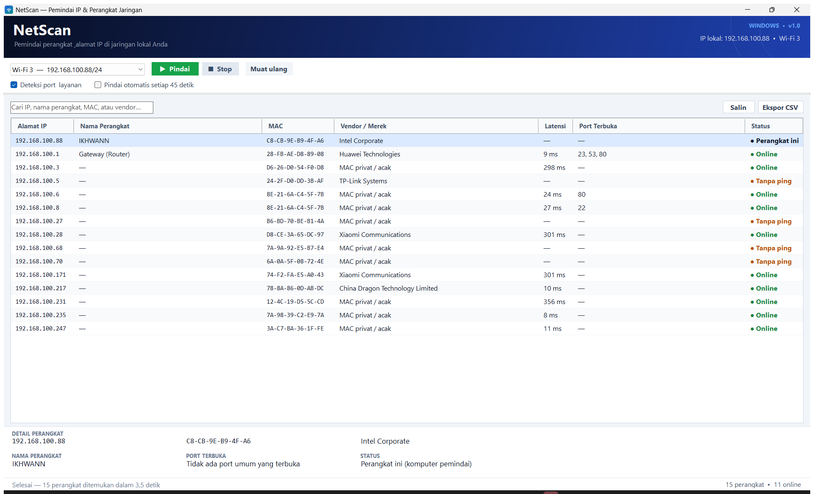

# NetScan v1.0

**Pemindai perangkat jaringan lokal — lihat siapa saja yang terhubung ke Wi-Fi/LAN kamu.**

NetScan adalah aplikasi ringan mirip [Fing](https://www.fing.com/) untuk **Android** dan **Windows**.
Deteksi otomatis jaringan aktif, lalu tampilkan daftar perangkat: alamat IP, MAC, vendor, nama
perangkat, latensi, dan port yang terbuka.

Tanpa iklan · Tanpa pelacakan · Tanpa koneksi ke internet · Semua data tetap di perangkat kamu.



---

## Fitur

| Fitur | Android | Windows |
| --- | :---: | :---: |
| Deteksi otomatis jaringan (Wi-Fi/Ethernet), subnet & gateway | ✅ | ✅ |
| Ping sweep paralel — jaringan `/24` selesai dalam hitungan detik | ✅ | ✅ |
| Perangkat yang memblokir ping tetap terdeteksi (tabel ARP/neighbour) | ✅ | ✅ |
| MAC address + **vendor/merek** (database OUI IEEE 38.900+ prefix) | ⚠️ ¹ | ✅ |
| Nama perangkat via reverse DNS & NetBIOS | ✅ | ✅ |
| Latensi (ms) per perangkat | ✅ | ✅ |
| Scan port umum + nama layanan (HTTP, HTTPS, SSH, SMB, RDP, Chromecast, printer, Plex, dll) | ✅ | ✅ |
| Panel detail perangkat | ✅ | ✅ |
| Ekspor / salin hasil ke **CSV** | ✅ | ✅ |
| Sortir & filter tabel | — | ✅ |
| Pemindaian otomatis berkala | — | ✅ |
| Buka perangkat ber-web-server langsung di browser | ✅ | ✅ |
| Tanpa installer, tanpa runtime tambahan | APK | 1 file `.exe` |

¹ Di Android 10+ sistem membatasi akses tabel ARP untuk aplikasi biasa (tanpa root), sehingga MAC
perangkat lain sering kosong. IP, nama, latensi, dan port tetap berfungsi normal.

---

## Unduh & pasang

Ambil file terbaru dari halaman [Releases](../../releases) atau langsung dari folder ini:

- **Android 7.0+** → [`NetScan-Android.apk`](NetScan-Android.apk)
- **Windows 10/11** → [`NetScan-Windows.exe`](NetScan-Windows.exe)

> `.apk` hanya untuk Android, `.exe` hanya untuk Windows. Keduanya aplikasi terpisah.

### Android

1. Salin `NetScan-Android.apk` ke HP (kabel USB, Google Drive, atau chat).
2. Buka berkasnya dan izinkan **"Instal dari sumber tidak dikenal"** bila diminta.
3. Sambungkan HP ke Wi-Fi yang sama dengan perangkat yang ingin dipindai.
4. Buka aplikasi — pemindaian berjalan otomatis.

Panduan lengkap: [`README-Android.md`](README-Android.md)

### Windows

1. Salin `NetScan-Windows.exe` ke PC (boleh di mana saja, tidak perlu installer).
2. Klik dua kali untuk menjalankan. Jika muncul SmartScreen, pilih
   **More info → Run anyway** (exe tidak ditandatangani digital).
3. Klik **Pindai** atau tekan **F5**.

Panduan lengkap: [`README-Windows.md`](README-Windows.md)

---

## Cara pakai singkat

1. Hubungkan perangkat ke jaringan yang ingin dipindai.
2. Jalankan NetScan — daftar perangkat muncul otomatis.
3. Ketuk/klik satu baris untuk melihat detail (nama, MAC, vendor, port terbuka).
4. Gunakan **Ekspor CSV** atau **Salin** untuk menyimpan hasil.

**Pintasan (Windows):** `F5` pindai · `Esc` stop · `Ctrl+F` cari · `Ctrl+S` ekspor.

---

## Cara kerja

1. **Ping sweep** seluruh subnet (timeout 500 ms, banyak thread paralel) untuk memancing resolusi ARP.
2. **Baca tabel ARP/neighbour** (`/proc/net/arp`, `ip neigh`, `arp -a`, `GetIpNetTable`) — perangkat
   yang memblokir ICMP tetap terdeteksi beserta MAC-nya.
3. **Detail**: reverse DNS + NetBIOS untuk nama perangkat, lalu koneksi TCP singkat ke port umum.
4. **Vendor MAC** dicocokkan dengan database OUI yang dikompres dan ditanam di dalam aplikasi.

Aplikasi hanya **membaca** informasi jaringan; tidak mengubah konfigurasi apa pun dan tidak
mengirim data ke internet.

---

## Batasan yang perlu diketahui

- **Client/AP isolation** (umum di Wi-Fi publik, tamu, atau kantor) membuat perangkat lain tidak
  terlihat meski berada di SSID yang sama.
- **Ping diblokir** — perangkat (terutama iPhone dan Windows dengan firewall ketat) tetap muncul
  dengan status "Tanpa ping" selama masih ada di tabel ARP.
- **Nama perangkat** hanya muncul jika router/DNS lokal menyediakan reverse DNS atau perangkat
  menjawab NetBIOS.
- **VPN aktif** dapat membuat subnet yang terbaca bukan jaringan Wi-Fi sebenarnya.
- **Android 10+** membatasi akses MAC address perangkat lain tanpa root (lihat catatan ¹).
- Jaringan lebih besar dari ±2046 host dipindai sebagian (batas pengaman).

---

## Build dari sumber

Kedua aplikasi bisa dibangun ulang tanpa IDE berat.

**Android** — butuh JDK 17 + Android SDK (diunduh otomatis oleh skrip):

```powershell
powershell -ExecutionPolicy Bypass -File .\NetScanAndroid\build.ps1
```

**Windows** — cukup compiler C# bawaan Windows (`csc.exe`):

```powershell
powershell -ExecutionPolicy Bypass -File .\NetScan\build.ps1
```

Detail toolchain, struktur proyek, dan pembuatan aset ada di
[`README-Android.md`](README-Android.md) dan [`README-Windows.md`](README-Windows.md).

---

## Privasi

NetScan tidak memiliki iklan, tidak mengumpulkan telemetri, dan tidak menghubungi server internet.
Semua pemindaian terjadi di jaringan lokal kamu.

## Atribusi

- Data OUI/vendor: IEEE MA-L, didistribusikan melalui
  [nmap-mac-prefixes](https://github.com/nmap/nmap/blob/master/nmap-mac-prefixes).
- Ikon dibuat secara programatik (tanpa aset pihak ketiga).

## Lisensi

Dirilis di bawah [MIT License](LICENSE).

## Penafian

Gunakan NetScan hanya pada jaringan yang kamu miliki atau yang kamu punya izin untuk mengaudit.
Pemindaian jaringan tanpa izin dapat melanggar hukum di beberapa yurisdiksi.

---

Dibuat November 2026 · NetScan v1.0
